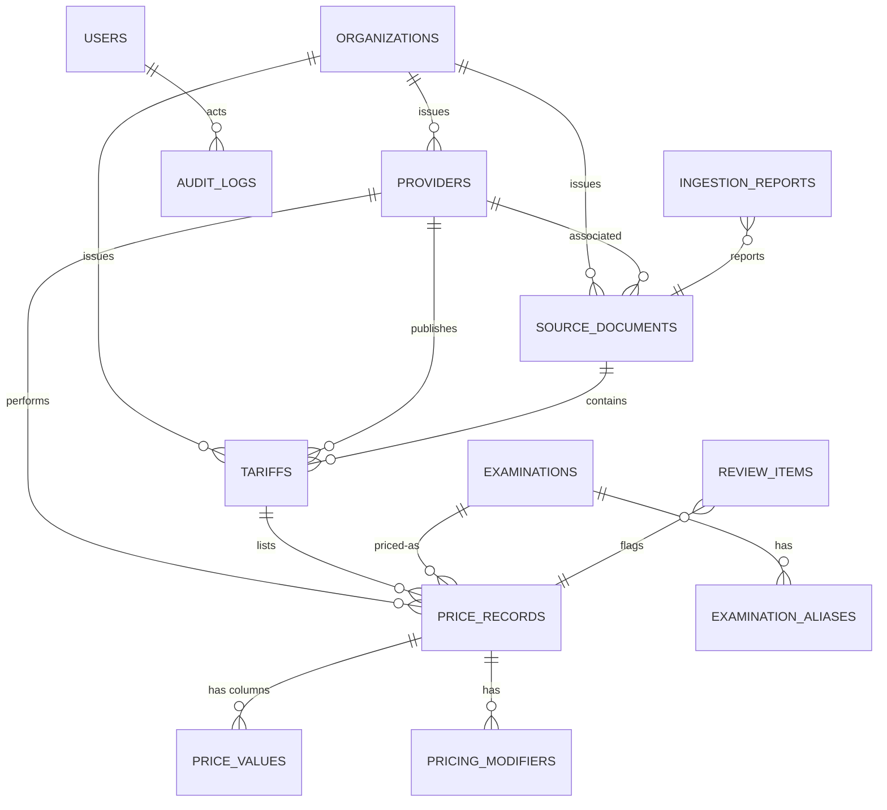

# Database schema & relationships



## Canonical example

```
examinations
  canonical_code = LAB-000001
  name_en        = Complete Blood Picture
  name_ar        = صورة دم كاملة
  category       = Laboratory
  subcategory    = Hematology
  attributes     = {}

examination_aliases (approved)
  CBC                → LAB-000001
  C.B.C              → LAB-000001
  C B C              → LAB-000001
  C-B-C              → LAB-000001
  Complete Blood Count → LAB-000001
  صورة دم كاملة       → LAB-000001
  تحليل صورة دم كاملة → LAB-000001
```

## Distinct variants that must never merge

| A | B | Why |
|---|---|---|
| CBC | CBC with Differential | different panel |
| MRI Brain | MRI Brain with Contrast | contrast |
| CT Abdomen | CT Abdomen and Pelvis | different region |
| X-ray Knee AP | X-ray Knee AP and Lateral | views |
| Urine Analysis | Urine Culture | different test |
| Qualitative HCV Ab | Quantitative HCV RNA | method + quantification |

## Price category vocabulary (this corpus)

| Category | Meaning |
|---|---|
| `member` | العضو (full listed price) |
| `member_project_50` | العضو × المشروع 50% |
| `member_parents_50` | العضو × الوالدين 50% |
| `parents_project_60` | الوالدين × المشروع 60% |
| `parents_project_40` | الوالدين × المشروع 40% |
| `cash` | self-pay lists (قصر العينى، المختبر) |
| `vip` / `first_class_premium` / `first_class_standard` / `second_class` | مستشفى الرحمة room classes |
| `project_*` | any other percentage share |

Comparison never mixes these as if they were the same product.
